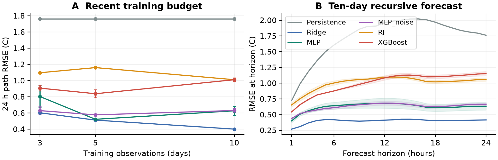
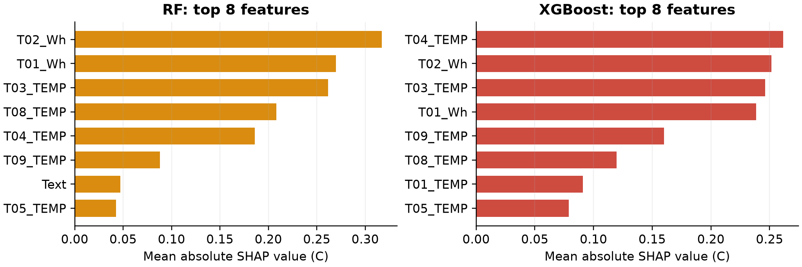

# Residential thermal prediction with limited and noisy sensor data

An independent PyTorch implementation of the **direct MLP mapping in Section 3.2,
Eq. (6)** of Vasisht et al. (2026), extended with Random Forest, XGBoost,
training-time temperature noise, and TreeSHAP explanations on an openly archived
nine-zone residential dataset. This implements the scope of the project outline;
it is **not a replication of the paper's commercial-building benchmark**, its
multi-step curriculum, or its physics-constrained architectures.

**Main result:** On the fixed clean ten-day case, Ridge has a 24-hour path RMSE of
0.401 C, followed by MLP (0.627 C); RF and XGBoost are about 1.011 C. Noise augmentation
helps the MLP in the three-day regime, but does not consistently improve clean-data
accuracy. The negative tree-baseline result is retained rather than retuned on test data.

[Public repository](https://github.com/yingzixu233/residential-thermal-benchmark) | [Individual report: 3 pages + references](report/individual_report.pdf)

## Reproduce

Python 3.12 is the tested version. From the repository root:

```bash
python -m venv .venv
# Windows: .venv\Scripts\activate
# macOS/Linux: source .venv/bin/activate
python -m pip install -r requirements.txt
python -m pytest -q
python -m thermal_benchmark.run --output results_reproduced
python -m thermal_benchmark.explain --results results_reproduced
python -m thermal_benchmark.figures --results results_reproduced
python -m thermal_benchmark.audit --results results_reproduced
python scripts/build_report.py --results results_reproduced --output report/reproduced_report.pdf
```

The checked-in `results/` contain the actual completed full run. Runtime was about
68 seconds for model selection plus evaluation on the task's Windows CPU environment;
SHAP and plotting take additional time. Timing is not a portable speed claim.
`requirements.txt` pins direct dependencies; `requirements-environment.txt` records
additional locally installed versions, and `results/manifest.json` records runtime
versions. CPU PyTorch 2.9.1+cpu was used (the portable requirement is torch==2.9.1).
No GPU is required. Full run: 6 model families x 3 budgets x 3 seeds x 3 test noise
levels = 162 evaluation settings, after 54 model-selection runs.

Quick smoke check:

```bash
python -m thermal_benchmark.run --days 3 --seeds 0 --noise 0 --epochs 30 --output results_smoke
```

SHAP needs the full run's ten-day, seed-zero models; do not run it on this smoke folder.
A small synthetic protocol test is included, but **all reported results use measured data**.

## Experimental protocol

Twenty inputs: nine indoor temperatures, nine hourly heating energies, outside
temperature and solar irradiance. Nine targets: next-hour zone temperatures.
All models predict absolute temperatures. Heating energy is used in its source Wh
units, with row t mapped to temperature at t+1. See `data/README.md` for provenance,
units and exact timestamps.

- Observations [0,240) form the training pool; recent windows of 72/120/240
  observations yield 71/119/239 training pairs. Validation [240,288) gives 47 pairs;
  test [288,385) gives 96 pairs. Split-boundary transitions are excluded.
- Feature and target scaling, where applicable, use training pairs only.
  Candidates and MLP checkpoints are selected on clean one-step validation RMSE.
  Validation observations are not used for gradient fitting or final refitting.
- Seeds 0, 1 and 2 control model randomness and paired input-noise realizations.
  Reported mean +/- sample SD is descriptive seed variability, not a confidence interval.
  Persistence and Ridge have zero variability with clean inputs.
- Test noise is independent Gaussian N(0, sigma^2), sigma = 0/0.2/0.5 C,
  on indoor temperatures only. Labels remain recorded measurements (not noiseless truth).
  The same noise is shared across models and budgets at each seed.
- One-step evaluation observes a new temperature input at each hour. Recursive
  evaluation observes temperature **only at each forecast origin**, then feeds
  predictions back for 24 steps. Noise is added only at initialization, not at
  every internal step. All 73 complete overlapping test origins are evaluated.
- Recorded future heating/weather are supplied to all recursive models. This is
  a conditional open-loop forecast, not an operational weather/control forecast.
  There is no clipping, teacher forcing, or test-temperature correction.
- `one_step`: MAE/RMSE across 96 timestamps x 9 zones. `rollout_path`: metrics
  across 73 origins x 24 horizons x 9 zones. `rollout_h24`: metrics at hour 24
  across 73 origins x 9 zones. Overlapping windows are not independent samples.
  Horizon-1 rollout uses 73 origins, so it need not equal the 96-point one-step metric.

## Models and the fixed search

| Model | Specification / validation candidates |
|---|---|
| Persistence | Next temperature = current temperature |
| Ridge | Train-only standardized inputs; alpha in {0.1, 1, 10, 100} |
| MLP | PyTorch 20-32-32-9, Tanh, standardized input/output; direct prediction |
| MLP_noise | Same MLP, fresh 0.2 C Gaussian noise on training temperature inputs each epoch |
| RF | Native nine-output forest, 200 trees; (depth, min leaf) = (6,2) or (unlimited,3) |
| XGBoost | Nine scalar regressors sharing all 20 inputs; 250 trees, depth 2 or 3, learning rate .03, lambda 5, subsample .9 |

MLPs use full-batch Adam, learning rate .003 or .01, weight decay 1e-4,
maximum 1500 epochs, checkpoint every 10 epochs, and 200-epoch patience.
Two hidden layers of width 32 follow the outline and lie in the paper's search
space; they are not asserted to be the original paper's unique best architecture.
Tanh, one-step training, these grids and the stopping rule are project choices.
There are four Ridge candidates and two per learned nonlinear family; search budgets
are deliberately small and not claimed to be equivalent or exhaustive.

## Recorded clean-input results (10 days)

| Model | 1 h RMSE (C) | 24 h path RMSE (C) | h=24 RMSE (C) |
|---|---:|---:|---:|
| Persistence | 0.654 | 1.760 | 1.761 |
| Ridge | 0.258 | 0.401 | 0.415 |
| MLP | 0.409 +/- 0.037 | 0.627 +/- 0.058 | 0.633 +/- 0.060 |
| MLP_noise | 0.474 +/- 0.016 | 0.630 +/- 0.024 | 0.665 +/- 0.019 |
| RF | 0.638 +/- 0.027 | 1.011 +/- 0.023 | 1.058 +/- 0.027 |
| XGBoost | 0.533 +/- 0.003 | 1.011 +/- 0.022 | 1.151 +/- 0.035 |



Noise augmentation lowers three-day MLP path RMSE from 0.803 to 0.629 C.
For ten-day one-step evaluation at 0.5 C input noise, MLP_noise reaches 0.495 C,
versus MLP 0.514 C and Ridge 0.803 C. These comparisons do not imply universal superiority.

## Shapley explanations

`thermal_benchmark.explain` uses interventional TreeSHAP on all 96 clean test
inputs for the ten-day, seed-zero RF and XGBoost models. The common background is
100 evenly spaced training inputs. Values explain each output's **one-step
absolute temperature**, in C. Mean absolute SHAP is averaged over test samples
and zones. All 864 predictions/model pass reconstruction within 1e-4 C.



RF's leading attribution is T02 heating; XGBoost's is T04 current temperature.
Indoor temperatures account for 54.2%/61.9% and heating for 42.0%/32.7% of total
mean absolute attribution (RF/XGBoost). These are attribution shares, not energy
shares or variance explained. Correlated zones and thermostat feedback prevent
causal interpretation. Interventional SHAP can evaluate unrealistic combinations
of correlated features; rankings depend on the background and fitted model.
SHAP is an explanation method, not a seventh predictive model. It does not
establish physical consistency or explain the full recursive rollout.

## Files

- `thermal_benchmark/`: data checks, model implementations, training, forecasting,
  SHAP, plots and result audit.
- `data/`: unchanged public CSV, archive metadata, attribution and license notes.
- `tests/`: chronological boundaries, recursive state/forcing alignment,
  paired noise, train-only preprocessing.
- `results/metrics.csv`, `by_zone.csv`, `by_horizon.csv`: all raw per-seed metrics.
- `results/summary.csv`: mean and sample SD across seeds.
- `results/selection.csv`, `training/*.json`: selected parameters and every validation trial.
- `results/predictions/*.npz`: saved one-step and rollout arrays for all 162 settings.
- `results/models/`: six ten-day seed-zero fitted models. Load only trusted joblib files.
- `results/shap/`: raw attributions, feature rankings and additivity audit.
- `report/individual_report.pdf`: three-page main report plus a separate reference page; all four generated figures are included.
- `scripts/build_report.py`: editable report source; all numerical tables read recorded results.

## Limits and scope

One house and about 16 days cannot establish seasonal or cross-building generalization.
Validation is only two days, and training budgets change both sample count and
historical conditions. We did not tune on test performance after seeing it.
The original paper uses a commercial emulator, broader architecture comparisons
and multi-step objectives; its reported errors are not directly comparable.
The extension is a public small-data benchmark plus RF/XGBoost/SHAP and a measured
noise-robustness study. It provides neither a PINN nor a hard physical guarantee.

## References and license

1. S. Vasisht et al. (2026). Physics vs structure: A systematic benchmark of learning
   strategies for multi-zone building thermal dynamics. Energy and Buildings 361,
   117472. https://doi.org/10.1016/j.enbuild.2026.117472
2. C. Vallianos (2023). Automated Multi-Zone Model Generation, v1.0.
   https://doi.org/10.5281/zenodo.10156745
3. C. Vallianos, A. Athienitis, B. Delcroix (2022). Automatic generation of multi-zone
   RC models using smart thermostat data from homes. https://doi.org/10.1016/j.enbuild.2022.112571
4. T. Chen and C. Guestrin (2016). XGBoost: A Scalable Tree Boosting System.
   https://doi.org/10.1145/2939672.2939785
5. L. Breiman (2001). Random Forests. https://doi.org/10.1023/A:1010933404324
6. S. Lundberg et al. (2020). From local explanations to global understanding with
   explainable AI for trees. https://doi.org/10.1038/s42256-019-0138-9

New benchmark code: AGPL-3.0-only; dataset licensing/provenance is documented separately
in `data/README.md`. Implementation, experiments and report were prepared with AI
assistance. Numerical results were computed by the included scripts; scientific
interpretations and the final submission should be reviewed by the named author.
